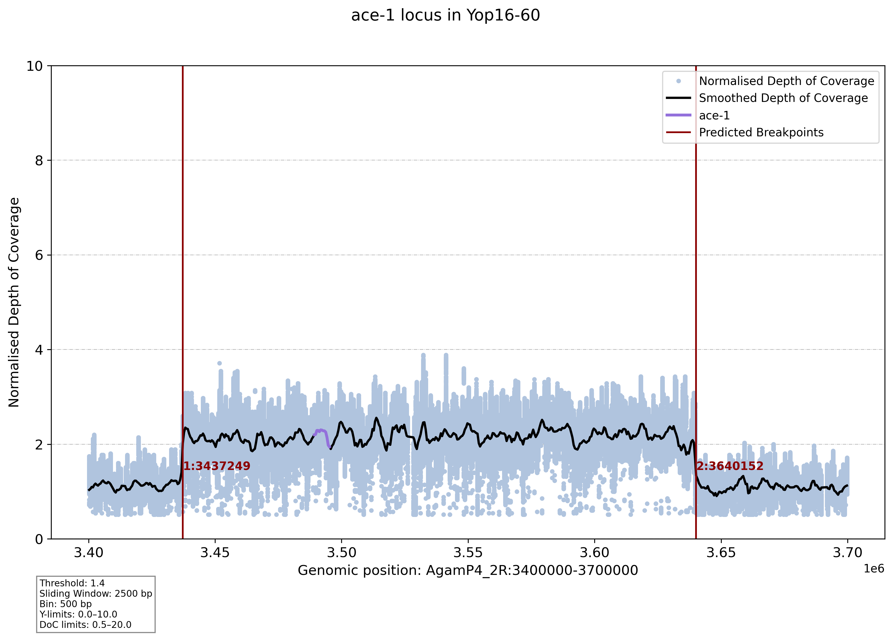
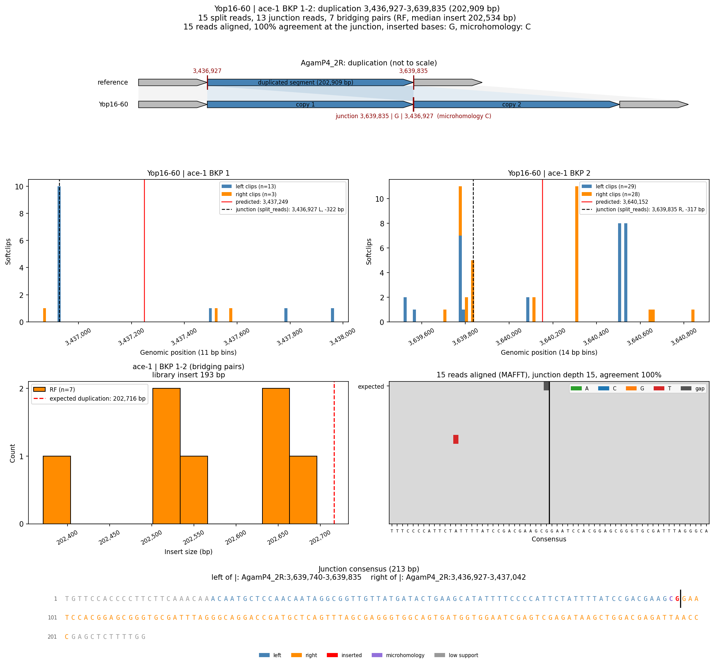

# Introducing Ar(chitecture of)Du(plications)
**Please bear with me as this readme -like ArDu- is still a Work In Progress**

ArDu is a tool designed to screen target loci for genomic duplications, provide estimates of their copy number, and identify their genetic architecture (i.e. breakpoints, copy numbers, secondary rearrangements). As it is entirely written in Python, it should be modular and easy enough to modify to accommodate the user's specific needs.

ArDu is now distributed as a proper Python package with four subcommands:

| Subcommand | Description |
|---|---|
| `ardu coverage` | Depth-of-coverage analysis, normalisation, copy number estimation, breakpoint detection |
| `ardu softclips` | Extract soft-clipped sequences around breakpoints, run BLAST |
| `ardu junctions` | Junction-read detection, bridging pairs, insert-size and softclip plots |
| `ardu parse` | Extract individual metric columns from a coverage TSV |

## Table of contents

- [Quick start](#quick-start)
- [Example run](#example-run----anopheles-gambiae-ace-1-duplication)
- [Installation](#installation)
- [ardu coverage](#ardu-coverage)
- [ardu softclips](#ardu-softclips)
- [ardu junctions](#ardu-junctions)
- [ardu parse](#ardu-parse)
- [Output files](#output-files)
- [Milesi's lab addendum](#milesis-lab-addendum)
- [Debugging](#debugging)
- [Gene copy number estimates, word of caution and best practices](#gene-copy-number-estimates-word-of-caution-and-best-practises)
- [Reference](#reference)

## Quick start

### Minimal run:
```bash
ardu coverage -b bamlist.txt -r regions.txt -n Reference -o output_prefix
```

### With plotting and breakpoint detection:
```bash
ardu coverage -b bamlist.txt -r regions.txt -n Reference -o output_prefix \
  --plot png --plot-threshold 1.4 --breakpoint ruptures --bkp-model l2 --bkp-pen 10
```

### Full junction evidence pipeline:
```bash
ardu coverage -b bamlist.txt -r regions.bed -n reference -o run1 \
  --plot png --breakpoint ruptures

ardu junctions -b bamlist.txt -i ArDuRun-run1-DATE/run1_breakpoints.tsv \
  -s 30 -e 1000 --pairs 1-2 --junction \
  --blast reference.fa --plot-insert --plot-softclip \
  -o JunctionTest
```

## Example run — *Anopheles gambiae* ace-1 duplication

The ace-1 locus is known to be involved in insecticide resistance linked to a gene duplication in *Anopheles gambiae* mosquitoes. Using a wild-caught sample from Yopougon (Ivory Coast) we identified a large tandem duplication spanning ~203 kb overlapping the ace-1 locus and 9 other genes.

The inputs are in `examples/ace1/`: the reads of this sample over AgamP4_2R:3.30-3.80 Mb (the duplication and its flanks) and AgamP4_X:8.040-8.065 Mb (the normalisation region), the region and plot beds, and AgamP4_2R up to 3.8 Mb as reference (original coordinates). Run the commands from that folder. The outputs shown below are in `docs/ExampleRun/ArDuRun-ArduExampleRun-2026-10-15/`.

### Step 1 — Coverage analysis and breakpoint detection

```bash
cd examples/ace1
ardu coverage -b bamlist.txt -n reference -r ace1.bed -o ArduExampleRun \
  --plot png --plot-interval ace1plot.bed --plot-slw 2500 --plot-bin 500 \
  --plot-target --plot-doclim 0.5 20 --plot-ylim 0 10 --plot-param \
  --breakpoint ruptures
```

The normalised depth of coverage rises from ~1 to ~2.2 at breakpoint 1 (AgamP4_2R:3,437,249) and drops back at breakpoint 2 (AgamP4_2R:3,640,152), consistent with a tandem duplication. The two predicted breakpoints are numbered in the same order as the `_breakpoints.tsv` output.

<p align="center">
  
</p>

### Step 2 — Junction evidence

```bash
mkdir -p ArDuRun-ArduExampleRun-DATE/junctions
ardu junctions -b bamlist.txt -i ArDuRun-ArduExampleRun-DATE \
  -s 30 -e 1000 --pairs 1-2 --junction \
  --blast AgamP4_2R_1-3800000.fa --plot-insert --plot-softclip --plot-evidence --report \
  -o ArDuRun-ArduExampleRun-DATE/junctions/JunctionTest
```

Fifteen split reads join the two breakpoints at the same junction, which refines them to AgamP4_2R:3,436,927 (left clips, first base of the duplicated segment, 322 bp upstream of the coverage prediction) and 3,639,835 (right clips, last base, 317 bp upstream). Both match the breakpoints confirmed by Assogba et al. (2016) to within 1 bp. The clip sides make it a tandem duplication of 202,909 bp. Seven read pairs bridge the junction, all in RF orientation as expected for a tandem duplication, and 13 reads contain the softclips of both breakpoints.

Aligned with MAFFT, the 15 reads crossing the junction reconstruct 213 bp of it: the end of the copy is joined to its start through a single inserted G, next to 1 bp of microhomology (C), and the consensus matches the reference at 97.2% (a few SNPs of this wild sample against the PEST reference). The full evidence is in `JunctionTest_junction_summary.tsv` and drawn in one figure:

<p align="center">
  
</p>

---

## Installation

### From GitHub (recommended):
```bash
git clone https://github.com/ClaretJeanLoup/ArDu.git
cd ArDu
pip install -e .
```

Or directly without cloning:
```bash
pip install git+https://github.com/ClaretJeanLoup/ArDu.git
```

### With conda:
`environment.yml` holds a minimal environment (the dependencies below, plus BLAST for `--blast` and pytest for the tests) and installs ArDu from the clone:
```bash
git clone https://github.com/ClaretJeanLoup/ArDu.git
cd ArDu
conda env create -f environment.yml
conda activate ardu
```

This installs all dependencies automatically and registers the `ardu` command.

### Dependencies
All dependencies are resolved automatically by pip:
`pysam`, `numpy`, `pandas`, `matplotlib`, `seaborn`, `ruptures`, `tqdm`, `pyahocorasick`, `scikit-learn`

### Verify installation:
```bash
ardu --help
```

### Run the tests:
The tests build small synthetic BAMs with known answers (copy number, low MAPQ reads, junction reads, homopolymer lengths), so no data is needed:
```bash
pip install -e ".[test]"   # or use the conda environment above
pytest
```

---

## ardu coverage

Depth-of-coverage analysis across target loci, normalisation by a reference region, optional plotting and breakpoint detection.

### Example run — *Anopheles gambiae* ace-1 gene duplication:
```bash
ardu coverage -b bamlist.txt -n reference -r ace1.bed -o AgambR \
  --plot png --plot-interval ace1plot.bed --plot-slw 2500 --plot-bin 500 \
  --plot-target --plot-doclim 0.5 20 --plot-ylim 0 10 --plot-param \
  --breakpoint ruptures
```

### Arguments

| Argument | Description | Default |
|---|---|---|
| **Mandatory** | | |
| `-b, --bam` | File listing BAM paths, one per line. All BAMs must be indexed (`samtools index`). | |
| `-r, --region` | 4-column tab-delimited BED-like file: `chromosome start stop locus_name`. Regions sharing a name are pooled. | |
| `-n, --norm` | Name of the normalisation locus in the region file. | |
| `-o, --outfile` | Prefix for output file names. | |
| **Read filters** | | |
| `--min-mapq` | Minimum mapping quality of reads counted in depth and mutation counts. Lower it for loci with identical paralog copies in the reference, whose reads get MAPQ 0. | `20` |
| `--min-baseq` | Minimum base quality counted in depth and mutation counts. | `13` |
| **RCN uncertainty** | | |
| `--rcn-ci` | Add a 95% interval to each RCN from N block bootstrap replicates (two extra fields per cell). | `0` (off) |
| `--ci-block` | Block size (bp) of the bootstrap; bases are resampled in blocks because neighbouring bases share reads. | `500` |
| `--ci-seed` | Random seed of the bootstrap. | `1` |
| **Parallelism** | | |
| `-t, --threads` | Number of parallel BAM processing workers. | `1` |
| **Plotting** | | |
| `--plot` | Produce per-sample plots. Accepts: png, jpeg, jpg, pdf, svg, eps. | `None` |
| `--plot-threshold` | Minimum normalised coverage to trigger plotting. | `1.4` |
| `--plot-interval` | Tab-delimited file of custom plot intervals: `locus_name\tchrom:start-stop`. | `None` |
| `--plot-proportion` | Extend plot window to X times the locus span. | `2` |
| `--plot-auto` | Automatically expand the plot interval by probing coverage outward. | `False` |
| `--probe-size` | Probe window size (bp). | `500` |
| `--probe-threshold` | Coverage ratio threshold for probe evaluation. | `0.8` |
| `--probe-number` | Number of probes per extension round. | `20` |
| `--probe-spacing` | Distance between probe starts (bp). | `1000` |
| `--probe-drops` | Consecutive low-coverage probes required to stop extension. | `10` |
| `--max-extension` | Maximum extension on each side of the target (bp). | `5000000` |
| `--plot-slw` | Sliding window size (bp) for coverage smoothing. | `1000` |
| `--plot-ylim` | Y-axis limits: two numbers, e.g. `0 4`. | `None` |
| `--plot-doclim` | Min and max normalised DoC for plotting. Supports `min`/`max`. | `None` |
| `--plot-target` | Highlight the target region on the plot. | `False` |
| `--plot-force` | Force plotting regardless of coverage threshold. | `False` |
| `--plot-covar` | Overlay covariance and variance tracks. | `False` |
| `--plot-bin` | Genomic bin size (bp) applied on top of sliding window. | `None` |
| `--plot-dpi` | Plot resolution (DPI). | `300` |
| `--plot-param` | Print run parameters on the plot. | `False` |
| `--plot-pooled` | Produce an additional pooled plot per locus with one line per sample. Combined with `--breakpoint ruptures`, runs multivariate ruptures across all samples jointly. | `False` |
| `--plot-pooled-raw` | Show per-base normalised scatter on pooled plots. | `False` |
| **Probe profiling** | | |
| `--probe-profile` | Build per-sample probe profiles around each locus. Combined with `--plot-pooled`, groups samples by structural similarity before running pooled ruptures. | `False` |
| `--probe-cluster-dist` | Maximum Hamming distance for probe-profile clustering. Lower = stricter grouping. | `0.15` |
| `--probe-n-each-side` | Number of probes on each side of the target. | `20` |
| `--probe-profile-out` | Write `_probe_profiles.tsv` with per-sample profile strings. | `False` |
| **Breakpoint detection** | | |
| `-bkp, --breakpoint` | Breakpoint detection method: `ruptures` or `rollingaverage`. | `None` |
| `--bkp-slw` | Window size for rolling-average detection (bp). | `1000` |
| `--bkp-nb` | Expected number of breakpoints (ruptures). | `2` |
| `--bkp-pen` | Find the number of breakpoints with a penalty instead of `--bkp-nb`. ruptures then runs on the mean normalised depth per bin (`--plot-bin`, else 500 bp), keeping a breakpoint when it lowers the cost by more than this value times the noise variance times log(number of bins), so the same value works whatever the depth, noise and region length. Each breakpoint is then placed at base level within 5 bins. About 10 suits depth data (both ace-1 examples: 2 and 4 breakpoints within 300 bp of their junctions); lower values find smaller steps. | `None` |
| `--bkp-model` | ruptures cost model. | `l2` |
| `--bkp-algo` | ruptures algorithm. | `BottomUp` |
| `--bkp-threshold` | Shift threshold for rolling-average method. | `0.5` |
| `--bkp-passes` | Smoothing passes for rolling-average method. | `1` |
| **Genotyping** | | |
| `--mutation` | Tab-delimited file: `chromosome position [mutation_name]`. Returns per-nucleotide read counts at each position. | `None` |
| `--mutation-indels` | With `--mutation`, also count reads with an insertion or a deletion right after each position (VCF-style anchor) and the length of the homopolymer run that follows it in each read. | `False` |

---

## ardu softclips

Extracts soft-clipped sequences from BAM files around each breakpoint, writes them to FASTA, and optionally runs BLAST against a reference genome to identify cross-mapping between breakpoints.

```bash
ardu softclips -b bamlist.txt -i run1_breakpoints.tsv -o run1 \
  -s 30 -e 30 --blast reference.fa --plot
```

### Arguments

| Argument | Description | Default |
|---|---|---|
| `-b, --bam_list` | File listing BAM paths, one per line. | |
| `-i, --input` | Breakpoints TSV from `ardu coverage`. | |
| `-o, --output` | Output file prefix. | |
| `-s, --size` | Minimum soft-clip length to extract (bp). | `30` |
| `-e, --extension` | Region to search around each breakpoint (bp). | `30` |
| `--blast` | Reference genome FASTA; triggers BLAST run and hit filtering. | `None` |
| `--pairs` | Allowed breakpoint pairs, e.g. `--pairs 1-2 3-4`. | `None` |
| `--plot` | Plot softclip density per sample per breakpoint. | `False` |

---

## ardu junctions

Full junction-evidence pipeline. Uses the breakpoints TSV from `ardu coverage` to:
1. Extract soft-clipped sequences around each breakpoint
2. Detect bridging read pairs (mates mapping at different breakpoints)
3. Optionally find spanning reads — single reads whose sequence crosses the junction (using an Aho-Corasick automaton)
4. Optionally run BLAST on all extracted softclips
5. Summarise and plot the insert size of read pairs, and plot softclip pileups

#### Insert sizes

Pairs are taken from the reads overlapping each breakpoint window (`-e`), keeping primary alignments that pass the mapping quality and flag filters, with the mate on the same chromosome. Each pair is counted once. The insert is the distance between the 5' ends of the two mates (the fragment length for a normal pair), computed from the mate CIGAR (`MC` tag, or `TLEN` without it), and the orientation is FR, RF, FF or RR.

The library insert is the median of the proper FR pairs. A pair is discordant when it is not FR or is more than 4 SD (from the MAD) above the library insert. With `--pairs`, the discordant pairs joining two breakpoints are compared with the insert expected for the SV: `S + L` in FR for a deletion of size `S`, `|L - S|` in RF for a tandem duplication (`L`, the library insert). Bridging pairs need windows wider than the library insert, so use a large `-e` (e.g. 1000).

#### Junction evidence

Two breakpoints are **joined** when the split reads and bridging pairs between them (or the junction reads, without split reads) reach `--min-support` (default 2). Only joined pairs are refined, called and plotted, so with more than two breakpoints (complex rearrangements, or a duplication with a deletion inside a copy) the steps in depth that are not junctions are not reported as SVs.

- Without `--pairs`, every pair of breakpoints within a locus is tested and only the joined ones are reported; ArDu prints them as `--pairs` to reuse.
- With `--pairs`, every requested pair is reported, with `joined` and `support` columns, and a warning for those not joined.

For each pair, the evidence is gathered in `*_junction_summary.tsv`:
- **split reads**: primary alignments clipped in one window whose supplementary alignment (`SA` tag) is clipped in the other. The junction most of them support gives the refined breakpoints; without split reads, the position with the most softclips in each window is used.
- **SV type and size** from the side of the clips: left clips at the left breakpoint and right clips at the right one make a tandem duplication (size from first to last duplicated base), the opposite makes a deletion (size of the deleted segment). `--sv-type` overrides it; without split reads, the bridging pair orientation decides.
- **junction reads** (with `--junction`), **softclips** per window and **bridging pairs** with their orientation, median and expected insert, the expected insert using the refined size.

`*_segments.tsv` gives, for each locus with two breakpoints or more, the median depth of each segment between consecutive breakpoints (refined ones when joined, else predicted) and of the flanks outside them (`--segment-flank`, default 10 kb), relative to the mean of the two flanks.

With `--plot-evidence`, a locus with three breakpoints or more also gets an **overview** figure: the reference segments with their depth relative to the flanks, each joined pair as an arc labelled with its SV type and support, and one possible haplotype built from them. Joined deletions and tandem duplications are applied outermost first; an event nested inside a duplicated segment is placed on one of its copies chosen at random (noted on the figure), or, for a deletion whose segment is less covered than the flanks, on both copies. The junction reads alone cannot tell these apart; only the depth can. Junctions that overlap without nesting are shown as arcs but not modelled.

`--report` gathers the same evidence in one PDF per sample and locus, one kind of evidence per page for every joined pair: structure (the overview with three breakpoints or more), softclips at both breakpoints, bridging pair inserts, junction read alignment and junction consensus.

`--plot-evidence` also draws one figure per sample and joined breakpoint pair: for a deletion or a tandem duplication, a schematic of the reference and the sample (not to scale) with the junction, its sequence and the segment depths; the softclips at both breakpoints (left and right clips stacked, with the predicted and refined positions) and the bridging pair inserts, with the call and its evidence in the title.

#### Junction sequence

With `--junction` and `--plot-evidence`, and [MAFFT](https://mafft.cbrc.jp/alignment/software/) installed, the junction reads and the split reads of each breakpoint pair are aligned with MAFFT (L-INS-i) and their consensus reconstructs the junction sequence. The junction is placed from the split reads, whose clip boundary in each read is known.

Given a reference (`--reference`, or the `--blast` one), the reads are added onto the junction expected from the refined breakpoints (`--addfragments`), which gives the bases inserted at the junction, the identity of the consensus with the expected junction, and the microhomology (bases found on both sides, which leave the exact breakpoint ambiguous within them). Long inserted sequences show only as far as the reads cover them.

The alignment is written as a text view (reads stacked under the consensus, `.` for agreement, `|` at the junction) and as an aligned FASTA, and drawn in the evidence figure: the reads around the junction, and the consensus sequence coloured by side of the junction, with inserted bases and microhomology highlighted, weakly supported bases faded, and the coordinates of each side.

All outputs are written to a `junctions/` subdirectory inside the existing `ArDuRun-*` output folder.

```bash
ardu junctions -b bamlist.txt -i ArDuRun-run1-DATE/run1_breakpoints.tsv \
  -s 30 -e 1000 --pairs 1-2 --junction \
  --blast reference.fa --plot-insert --plot-softclip \
  -o JunctionTest
```

### Arguments

| Argument | Description | Default |
|---|---|---|
| `-b, --bam_list` | File listing BAM paths, one per line. | |
| `-i, --input` | Breakpoints TSV from `ardu coverage`. | |
| `-o, --output` | Output prefix (written inside `junctions/` in the ArDuRun directory). | |
| `-s, --size` | Minimum soft-clip length to extract (bp). | `30` |
| `-e, --extension` | Region to search around each breakpoint (bp). | `30` |
| `--blast` | Reference genome FASTA; triggers BLAST and hit filtering. | `None` |
| `--pairs` | Restrict analysis to specific breakpoint pairs, e.g. `--pairs 1-2 3-4`. | `None` |
| `--junction` | Find reads whose sequence physically spans the breakpoint junction. | `False` |
| `--junction-fastq` | Write spanning reads as FASTQ instead of FASTA. | `False` |
| `--sv-type` | SV type used for the expected insert of bridging pairs: `auto`, `deletion` or `duplication`. `auto` picks the type the pair orientations support (FR: deletion, RF: tandem duplication), which assumes the SV is longer than the library insert. | `auto` |
| `--plot-insert` | Plot insert-size distributions. | `False` |
| `--plot-softclip` | Plot softclip pileup per breakpoint, left and right clips stacked, with predicted and refined positions. | `False` |
| `--plot-evidence` | Plot softclips at both breakpoints and the bridging pair inserts of each breakpoint pair, with the evidence summary. With `--junction` and MAFFT, also align the junction reads. | `False` |
| `--min-support` | Split reads plus bridging pairs (junction reads without split reads) needed to join two breakpoints and call an SV. | `2` |
| `--segment-flank` | Length of the flanks outside the first and last breakpoints that segment depths are compared with (bp). | `10000` |
| `--reference` | Indexed reference FASTA for the expected junction and microhomology. Defaults to the `--blast` reference. | `None` |
| `--report` | Write one PDF per sample and locus with one kind of evidence per page (structure, softclips, insert sizes, junction read alignment, junction consensus). | `False` |
| `--plot-mode` | `per-bam`, `pooled`, or `both`. | `per-bam` |

### Output files

| File | Description |
|---|---|
| `*_bridging_pairs.tsv` | Discordant read pairs with one mate in each of two breakpoint windows of the same locus, each pair listed once. Contains BAM file, locus, read name, positions of both mates, insert size, orientation, proper pair flag and breakpoint bridge. |
| `*_junction_summary.tsv` | One row per sample and breakpoint pair: predicted and refined breakpoints (with clip side and source), SV type and size, split reads, junction reads, softclips per breakpoint, bridging pairs with orientation, median and expected insert; with a reference, the microhomology; with the alignment, reads aligned, consensus length, depth and lowest agreement around the junction, inserted bases and identity with the expected junction. |
| `*_{sample}_{locus}_1-2_junction_alignment.txt` | Junction and split reads stacked under their consensus, with the junction marked. |
| `*_{sample}_{locus}_1-2_junction_msa.fasta` | The MAFFT alignment, with the consensus (and the expected junction with a reference). |
| `*_segments.tsv` | Median depth of each segment between consecutive breakpoints and of the flanks, relative to the flanks. |
| `*_insert_summary.tsv` | Per BAM (and `pooled`): the library insert (median, quartiles and MAD of proper FR pairs), then n, median and quartiles of the bridging pairs per breakpoint pair (with `--pairs`) or of the discordant pairs per breakpoint, by orientation, with the SV type and expected insert. |
| `*_soft_clipped_sequences.fasta` | All extracted soft-clipped sequences. |
| `*.tsv` | Per-read softclip details (position, CIGAR, mate position, insert size). |
| `*_BLAST_results.txt` | Raw BLAST output (if `--blast` used). |
| `*_BLAST_filtered_pairs.txt` | BLAST hits filtered to cross-breakpoint mappings. |
| `{sample}_{locus}_1-2_junction_reads.fasta` | Reads spanning the junction (if `--junction` used). |
| `*_{sample}_insert_dist.png` | Insert sizes of the bridging (or discordant) pairs, stacked by orientation, with the expected insert. |
| `*_{sample}_softclip_dist.png` | Softclip pileups, left and right clips stacked, with predicted and refined breakpoint positions. |
| `*_{sample}_{locus}_report.pdf` | Evidence report, one page per kind of evidence (if `--report` used). |
| `*_{sample}_{locus}_overview.png` | For a locus with three breakpoints or more: segments, joined pairs and one possible haplotype (if `--plot-evidence` used). |
| `*_{sample}_{locus}_1-2_evidence.png` | Softclips at both breakpoints and bridging pair inserts, with the SV call and its evidence (if `--plot-evidence` used). |

---

## ardu parse

Extracts individual metric columns from the semicolon-separated `coverage.tsv` columns, into a more user-friendly matrix. At least one field flag must be provided. Missing or malformed entries are converted to `NA`. Output is a wide-format matrix: first column is `locus`, each additional column is tagged with a `sample_field` combination.

Optionally, columns can be filtered by the value at a specific locus row, and the output can be written as a simple header list (e.g. to generate a BAM file list for downstream ArDu runs).

### Basic usage

```bash
ardu parse -i run1_coverage.tsv -o run1_rcn.tsv --RCN --medDOC
```

### Filter columns by value at a specific locus

Keep only samples where RCN > 1.4 at locus `ace1`, output as TSV:
```bash
ardu parse -i run1_coverage.tsv -o run1_rcn_filtered.tsv --RCN \
  --filter "ace1:>:1.4"
```
Alternatively, you can use the explicit flags:
```bash
ardu parse -i run1_coverage.tsv -o out.tsv --RCN \
  --filter-locus "ace1" --filter-op ">=" --filter-value 1.4
```

### Output as a header list (e.g. for bam lists)

Write one column name per line instead of a tsv file, optionally appending a suffix for downstram ArDu run:
```bash
ardu parse -i run1_coverage.tsv -o bam_list.txt --RCN \
  --filter "ace1:>:1.4" --format list --suffix .bam
```

This produces a file ready to pass to `-b` in `ardu coverage` or `ardu junctions`.

### Arguments

| Argument | Description | Default |
|---|---|---|
| **Mandatory** | | |
| `-i, --input` | Input ArDu coverage TSV. | |
| `-o, --output` | Output file (TSV matrix or header list). | |
| **Metric selection** | | |
| `--uDOC` | Extract mean depth of coverage. | |
| `--sdDOC` | Extract standard deviation. | |
| `--medDOC` | Extract median depth of coverage. | |
| `--CovBases` | Extract covered bases. | |
| `--RCN` | Extract relative copy number. | |
| `--RCNlow`, `--RCNhigh` | Extract the bounds of the RCN interval (coverage run with `--rcn-ci`). | |
| **Filtering** | | |
| `--filter` | Filter columns by value at a locus. Format: `LOCUS:OP:VALUE`, e.g. `ace1:>:1.4`. Loci containing colons are supported (split from the right). | `None` |
| `--filter-locus` | Locus row to filter on (use with `--filter-op` and `--filter-value`). | `None` |
| `--filter-op` | Comparison operator: `>`, `<`, `>=`, `<=`, `==`, `!=`. | `None` |
| `--filter-value` | Numeric threshold for the filter. | `None` |
| **Output format** | | |
| `--format` | `tsv` — full filtered matrix (default); `list` — one column header per line. | `tsv` |
| `--suffix` | Suffix appended to each header in `list` mode, e.g. `.bam`. | `""` |

---

## Output files

### `ArDuRun-{prefix}-{date}/`

All outputs from `ardu coverage` are written to a timestamped directory. A second run with the same prefix on the same day goes to `ArDuRun-{prefix}-{date}_2`, `_3`, ... instead of overwriting the first.

| File | Description |
|---|---|
| `*_coverage.tsv` | Per-locus coverage statistics, one semicolon-packed field per sample. Format: `uDoC;sdDoC;medDoC;CovBases;RCN`, followed by `;RCN_low;RCN_high` with `--rcn-ci`. RCN is written with 4 decimals. |
| `*_breakpoints.tsv` | Predicted breakpoint positions (if `--breakpoint` used). Numbered in the same order as the plot. |
| `*_mutations.tsv` | Per-position nucleotide counts (if `--mutation` used). Format: `A=;T=;C=;G=;depth=`, followed by `;ins=;del=;runs=` with `--mutation-indels` (e.g. `runs=T8:12,T9:3,T10:5`). |
| `{locus}-plots/` | Per-locus plot directory. Contains per-sample and pooled plots. |
| `junctions/` | All outputs from `ardu junctions` (created automatically). |

---

*Now go out there and hunt some duplications!*

---

## Debugging

```
Error processing BAM file TestRun.bam: no index available for pileup
```
→ No index found. Check for `.bai` files in the .bam directory and make sure their names match the BAM files.

```
Error processing BAM file TestRun.bam: invalid literal for int() with base 10: 'st'
```
→ Invalid line in the `-r` region file. Make sure the file doesn't have a header.

---

## Gene Copy Number Estimates, word of caution and best practises

ArDu uses depth of coverage from BAM alignment files to estimate copy number at target loci, normalised by a user-provided reference. Depending on the reference used, this normalised depth can be directly used as a copy-number proxy (Claret et al. 2023).

The choice of reference is critical. A wide range of genomic intervals can be used, from whole chromosome to a single gene, but we have seen consistent improvement in precision when using exonic sequences of a few housekeeping genes. Be aware that really large copy number variations (e.g. in the hundreds) will produce noisy epth of coverage profiles and wil lresults in poor CN estimates. 

RCN is the median depth of the locus divided by the median depth of the normalisation locus, so it counts copies per copy of the normalisation locus. With a single copy gene of a diploid genome as reference, RCN = 1 means two copies per cell; multiply by two for copies per diploid cell. Use `--rcn-ci` to judge whether a value differs from 1.

Reads in identical paralog copies present in the reference get MAPQ 0 and are dropped by the default `--min-mapq 20`, which flattens the depth of such duplications. Lower `--min-mapq` (e.g. to 0) when the reference contains both copies.

ArDu is specifically designed around a candidate locus approach. While it can handle large numbers of targets, it is not its intended use, so expect long run times and reduced usability at genome wide scale.

---

## Reference
If you use ArDu, please cite:
Claret Jean-Loup, Mestre Camille, Milesi Pascal and Labbé Pierrick, *in prep*.
**DOI:** [10.5281/zenodo.14922764](https://doi.org/10.5281/zenodo.14922764)
